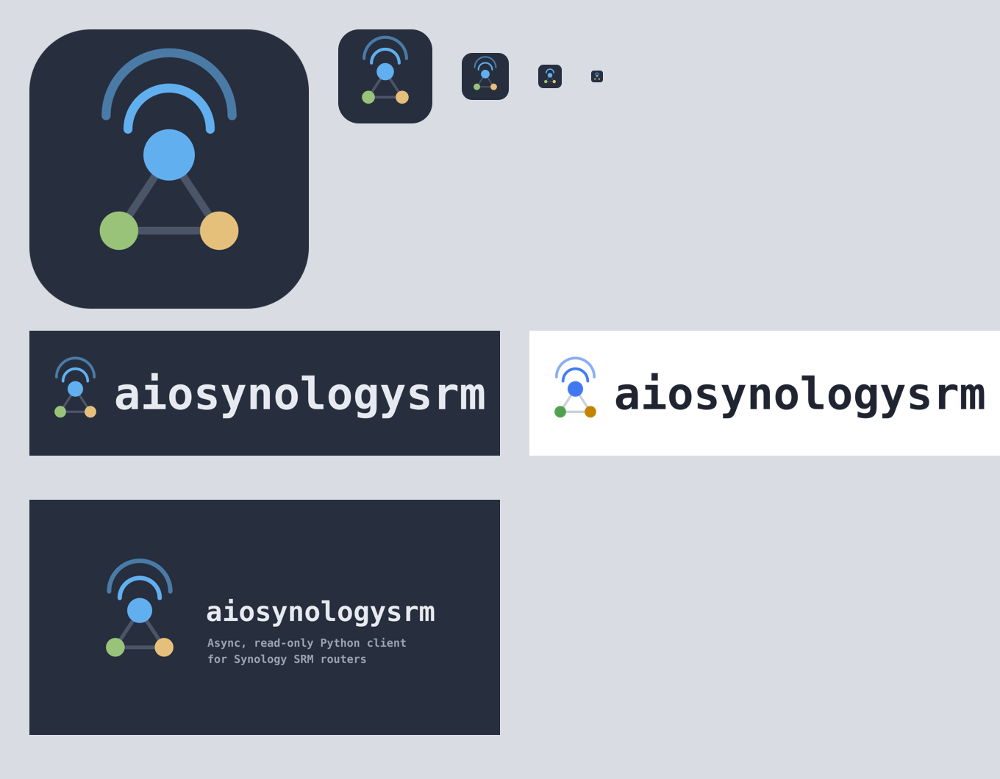

# brand

Logos, icons and preview images of [eizedev](https://github.com/eizedev) and his projects, with
the scripts that draw them. Every image here is generated, so a change is made in a build script
and the image is rebuilt, never edited by hand.



## What is where

| Folder | What |
| --- | --- |
| [`eizedev/`](eizedev/) | the personal ❯e_ logo: avatar, icons, marks, wordmarks, social preview, favicons |
| [`aiosynologysrm/`](aiosynologysrm/) | icon, README header and social preview of [aiosynologysrm](https://github.com/eizedev/aiosynologysrm) |
| [`lib/brand.py`](lib/brand.py) | shared palette, font outlines, SVG and PNG output |
| [`fonts/`](fonts/) | DejaVu Sans Mono Bold with its license |

Each project folder has a `build.py`, an `overview.png` contact sheet to review all variants at a
glance, and its output files.

## Style

All marks use the [One Dark](https://github.com/joshdick/onedark.vim) palette on dark
backgrounds and One Light on light ones. Lettering is DejaVu Sans Mono Bold, converted to paths,
so the SVGs look the same everywhere without the font installed.

| Role | Dark | Light |
| --- | --- | --- |
| Background | `#272e3d` | `#ffffff` |
| Green | `#98c379` | `#50a14f` |
| Blue | `#61afef` | `#4078f2` |
| Yellow | `#e5c07b` | `#c18401` |
| Text | `#e6e9ef` | `#1f2430` |

## Building

You need [uv](https://docs.astral.sh/uv/) and `rsvg-convert` (macOS: `brew install librsvg`,
Debian/Ubuntu: `apt install librsvg2-bin`). The scripts declare their own Python dependencies.

```sh
uv run eizedev/build.py
uv run aiosynologysrm/build.py
```

## Using the images in a project

Copy the generated files the project needs into that project's repository (for example
`assets/`) and reference them relatively, so the README also works in forks. Keep the source here.

## Adding a project

Create `<project>/build.py` next to the existing ones, import the shared parts from
`lib/brand.py`, write the output into the project folder and add a row to the table above. Icons
that are shown small get a simplified variant from 32 px down, as `aiosynologysrm` does.
